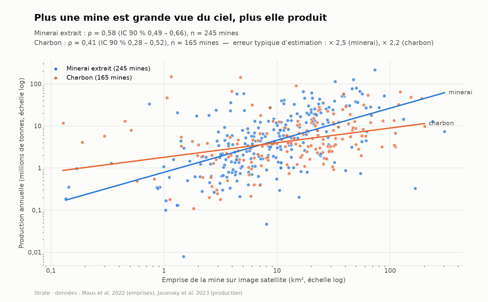
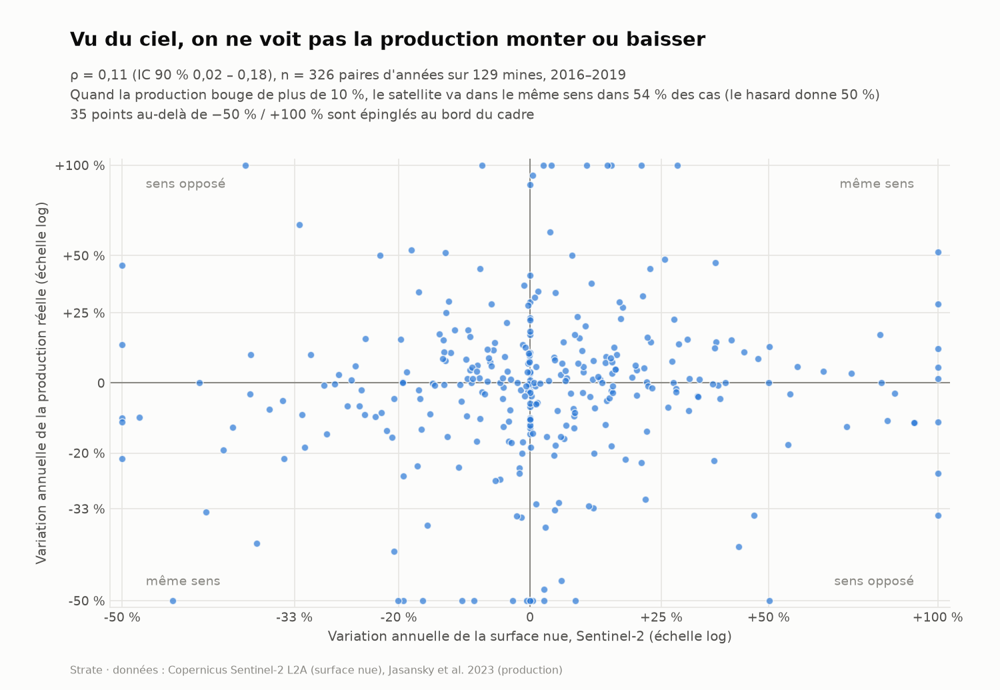
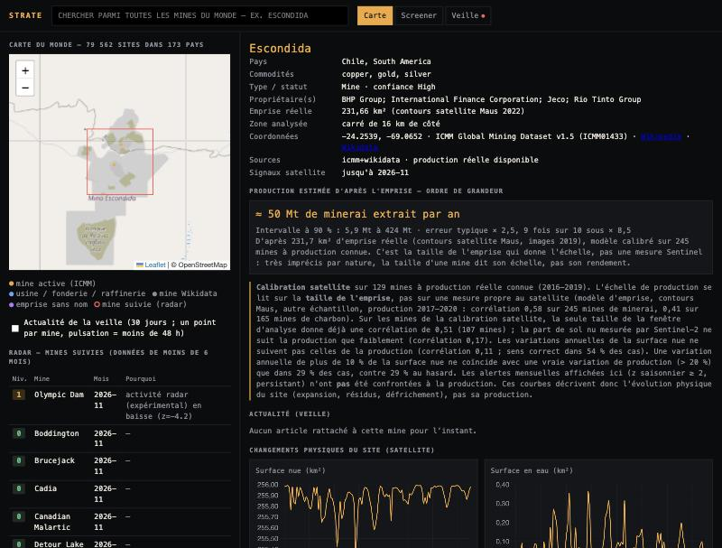

# Strate

> Développé en privé en 2026, publié en open source en novembre 2026.
> *Developed privately in 2026, open-sourced in November 2026.*

Terminal open source d'*alternative data* pour le secteur minier. Strate rassemble ce que les
terminaux financiers classiques ne couvrent pas : un catalogue mondial des mines, des images satellite,
l'actualité minière de toutes les langues, et les données publiques des sociétés. Chaque relation
affichée l'est avec son coefficient de corrélation, son intervalle de confiance et le nombre
d'observations.

*Open-source alternative-data terminal for mining: a merged world mine catalogue, Sentinel-1/2
satellite signals calibrated against reported production, a 24/7 multilingual news pipeline, and
company filings data. Every relationship is shown with its correlation coefficient and confidence
interval.*

<picture>
  <source media="(prefers-color-scheme: dark)" srcset="docs/img/emprise-production-sombre.png">
  
</picture>

<picture>
  <source media="(prefers-color-scheme: dark)" srcset="docs/img/variations-satellite-sombre.png">
  
</picture>

La taille d'une mine vue du ciel dit l'ordre de grandeur de sa production ; ses variations d'une
année sur l'autre ne disent presque rien des variations de production. Strate publie les deux
résultats. Graphiques régénérables avec `uv run python scripts/figures.py`.

<picture>
  <source media="(prefers-color-scheme: dark)" srcset="docs/img/fiche-mine-sombre.jpg">
  
</picture>

## Ce que fait Strate

| Module | Contenu |
|---|---|
| **Catalogue mondial** | 79 562 sites dans 173 pays, fusionnés et dédoublonnés à partir de 6 sources ouvertes ; emprise réelle de 26 000 sites (contours satellite) ; production publiée de 1 015 mines. |
| **Screener** | Filtres par pays (noms français acceptés), commodité, catégorie, emprise, production estimée ou réelle, alertes et zone de la carte ; tri, export CSV, analyse satellite par lots. |
| **Satellite** | Analyse à la demande de n'importe quelle mine : Sentinel-2 (surface nue, eau, défrichement) et Sentinel-1 radar (à travers nuages et neige), mois par mois depuis 2020. |
| **Calibration** | Signaux confrontés à la production réelle d'environ 130 mines, avec jeu de test tenu à l'écart. Résultats détaillés dans [docs/calibration.md](docs/calibration.md). |
| **Veille** | Chaîne qui tourne en continu : collecte de l'actualité minière mondiale (GDELT, anglais et ~65 langues traduites), vérification, rattachement de chaque article à une mine, classement (accident, grève, juridique, environnement, production, finance), puis test statistique du lien avec les anomalies satellite. Voir [docs/veille.md](docs/veille.md). |
| **Sociétés** | CAPEX, chiffre d'affaires, dépenses d'exploration, actifs miniers et effectifs (SEC EDGAR XBRL, Wikidata), détention datée des mines, investissements annoncés extraits de la veille et classés par type ; corrélations société ↔ mines sur les croissances annuelles, avec q-valeurs de Benjamini-Hochberg. Voir [docs/previsions-societes.md](docs/previsions-societes.md). |
| **Prévisions** | Prévision de la production par mine jusqu'à 10 ans, évaluée par rétro-test (« walk-forward » : réglage sur 2000–2014, test sur 2015–2021) contre la prévision naïve, avec couverture mesurée des intervalles et registre daté des prévisions pour les noter quand le réel arrive. |
| **Interface** | Menus Explorer, Veille, Sociétés, Prévisions et Méthode ; chaque relation affichée porte une pastille avec coefficient, IC 90 %, n et verdict. Thème clair et sombre. |

## Ce que disent les données

Strate publie ses conclusions négatives au même titre que les positives.

| Question | Résultat (IC 90 %) |
|---|---|
| La taille de l'emprise d'une mine indique-t-elle l'échelle de sa production ? | **Oui** : 0,58 (0,49 – 0,66) sur 245 mines de minerai, 0,41 (0,28 – 0,52) sur 165 de charbon ; 0,51 (0,37 – 0,63) sur l'échantillon satellite de 107 mines |
| L'image satellite ajoute-t-elle de l'information à la taille ? | Peu : 0,17 (0,00 – 0,33) |
| Les variations annuelles de surface suivent-elles celles de la production ? | **Non** : bon sens dans 54 % des cas (48 – 60 %) |
| Le radar suit-il les variations de production ? | **Non démontré** : 56 % (47 – 64 %) |
| Un modèle prévoit-il la production d'une mine mieux que « comme l'an dernier » ? | **Non** : gain moyen −0,7 % (−1,3 – −0,01 %) sur 676 mines, horizons 1 à 10 ans ; la prévision naïve est retenue |
| Les intervalles de prévision tiennent-ils leur promesse ? | **Presque** : les intervalles à 90 % contiennent le réel dans 88,5 à 89,5 % des cas, ceux à 80 % dans 77 à 80 % |
| Le CAPEX d'une société annonce-t-il la production de ses mines ? | **Pas encore testable** : avec une détention datée, 2 groupes de sociétés indépendants seulement ; Strate n'affiche aucun verdict sous ce seuil |
| Ordre de grandeur de production d'après l'emprise | Erreur typique ×2,5 (minerai, 245 mines) et ×2,2 (charbon, 165 mines) |

Conséquence : les alertes satellite décrivent des changements physiques d'un site (expansion,
défrichement, résidus), pas sa production. La seule estimation publiée est un ordre de grandeur,
toujours affiché avec son intervalle. Les prévisions publiées sont celles du modèle naïf, avec leurs
intervalles mesurés, et l'outil se note lui-même à mesure que les productions réelles arrivent.

## Démarrer

Prérequis : macOS ou Linux, [uv](https://docs.astral.sh/uv/).

```bash
git clone https://github.com/antoine-routaboul/strate.git
cd strate
uv sync
uv run strate catalog        # télécharge les sources ouvertes et construit le catalogue (~15 min)
uv run strate serve          # interface sur http://127.0.0.1:7779
```

Commandes utiles :

```bash
uv run strate update             # signaux satellite des mines suivies
uv run strate veille once        # un cycle de veille (collecte → vérification → corrélations)
uv run strate veille install     # veille en continu (launchd sur macOS, systemd sur Linux)
uv run strate calibrate report   # régénère toute la calibration (plusieurs heures)
uv run strate forecast backtest  # rétro-test des prévisions
uv run strate companies refresh  # données sociétés (SEC, Wikidata)
uv run pytest -q                 # tests
```

Pour les données SEC, définir un en-tête d'identification, que la SEC demande :
`export STRATE_SEC_UA="Votre-organisation contact@exemple.com"` (sinon un en-tête générique est utilisé).

Pour faire tourner la veille 24 h/24 sur une petite machine Linux dans le cloud (Azure, offre gratuite), voir
[docs/deploiement-azure.md](docs/deploiement-azure.md).

## Architecture

```
src/strate/
  catalog.py      fusion des sources → data/catalog/mines.parquet
  screener.py     table filtrable de tous les sites
  modules/        signaux par mine : optical (Sentinel-2), radar (Sentinel-1), attention (Wikipedia)
  fusion.py       moteur d'alertes (scores z saisonniers, persistance, convergence de familles)
  calibrate.py    confrontation à la production réelle
  veille/         collect → normalize → correlate, daemon, base SQLite partagée
  companies.py    sociétés : faits financiers, investissements, corrélations
  forecast.py     prévisions et rétro-test
  api.py          API FastAPI + widgets OpenBB Workspace (/widgets.json)
  web/            interface
```

Les données téléchargées et calculées (`data/`) ne sont jamais versionnées : chaque utilisateur les
récupère depuis leur source d'origine.

## Sources et licences

| Source | Usage | Licence |
|---|---|---|
| [ICMM Global Mining Dataset v1.5](https://www.icmm.com/en-gb/research/data/2025/global-mining-dataset) | mines, usines, fonderies actives | CC BY 4.0 |
| [Wikidata](https://www.wikidata.org) | mines, propriétaires, noms dans toutes les langues, effectifs | CC0 |
| [Wikipedia, *Lists of mines*](https://en.wikipedia.org/wiki/Lists_of_mines) | mines absentes de Wikidata, noms alternatifs | CC BY-SA 4.0 |
| [Maus et al. 2022](https://doi.org/10.1594/PANGAEA.942325) | contours satellite des mines | CC BY-SA 4.0 |
| [Jasansky et al. 2023](https://doi.org/10.5281/zenodo.7369478) | production réelle 2000–2021 | CC BY 4.0 |
| Copernicus Sentinel-1 et 2 (via Microsoft Planetary Computer) | images satellite | libre, attribution |
| [GDELT](https://www.gdeltproject.org) | actualité mondiale | utilisation libre, attribution |
| [SEC EDGAR](https://www.sec.gov/edgar) | données financières XBRL | domaine public |

## État du projet

En développement actif. Prochaines étapes : vérité terrain récente (rapports trimestriels 2020 →) pour
valider sur les années récentes, rattachement plus fin des articles aux mines homonymes, historique des
propriétaires au-delà des mines suivies.

## Licence

Code sous licence [Apache 2.0](LICENSE).
